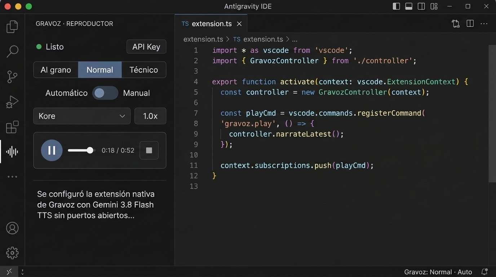

# Gravoz AI

**Asistente de voz inteligente para Google Antigravity IDE.**

**Gravoz AI** integra narración por voz natural directamente en **Antigravity IDE**. Escucha automáticamente cada plan o solución del asistente, comprende el contexto de tu proyecto activo y te lo explica con voces de **Google Gemini** sin interrumpir tu flujo de programación.

---

## Características principales

- **3 niveles de detalle**:
  - **Al grano** *(15–30s)*: resumen ejecutivo con qué cambió y cuál es el siguiente paso.
  - **Normal** *(45–80s)*: explicación clara y conversacional conectada a tu proyecto.
  - **Técnico** *(90–150s)*: recorrido de arquitectura, flujo de datos y módulos afectados.
- **8 voces de estudio (Mujer y Hombre)**: `Kore`, `Aoede`, `Zephyr`, `Leda`, `Charon`, `Orus`, `Puck` y `Fenrir`.
- **Español por defecto + Inglés opcional**: cambio en 1 clic (`ES` / `EN`), con traducción automática de respuestas o logs técnicos.
- **Control rápido desde la barra inferior**: cambia de nivel, alterna entre modo **Automático** y **Manual**, reproduce o detén el audio sin necesidad de abrir el panel lateral.
- **Explicación de código con clic derecho**: selecciona cualquier fragmento de código o error en el editor → clic derecho → **`Gravoz: Explicar selección con voz`** (`Ctrl+Alt+E`).
- **Copia rápida del resumen (`📋 Copiar`)**: copia el guion limpio generado por Gravoz en 1 clic para usarlo en commits, PRs o documentación.
- **Filtro inteligente de respuestas breves**: ignora automáticamente confirmaciones de una sola línea en modo Automático para no interrumpirte ni consumir cuota innecesaria.
- **Sugerencias opcionales (`Sugerencias: OFF/ON`)**: desactivadas por defecto para mantener explicaciones fieles a la respuesta; actívalas cuando quieras detectar posibles puntos ciegos.
- **Memoria de contexto por proyecto**: mantiene el hilo de tu sesión de forma independiente en cada ventana del editor.
- **Caché instantánea y gestión de cuota gratuita**: cambio inmediato entre niveles ya escuchados, rotación automática entre modelos de voz disponibles y soporte para hasta 3 claves de respaldo opcionales.

---

## Instalación

### Desde la tienda de Extensiones de Antigravity IDE (Recomendado)
1. Abre la pestaña **Extensiones** (`Ctrl+Shift+X` / `Cmd+Shift+X`) en Antigravity IDE.
2. Busca **`Gravoz AI`** (`mylnzon58.gravoz`) o visita [Open VSX Registry](https://open-vsx.org/extension/mylnzon58/gravoz) y pulsa **Install**.
3. Abre el icono de **Gravoz AI** en la barra lateral y conecta tu clave gratuita de [Google AI Studio](https://aistudio.google.com/apikey).

### Instalación manual (`.vsix`)
1. Descarga `gravoz-1.0.12.vsix` desde [GitHub Releases](https://github.com/mylnzon58/gravoz/releases/latest).
2. En Antigravity IDE, ve a **Extensiones** → menú `...` → **Install from VSIX…** y selecciona el archivo.

---

## Atajos y controles rápidos

- **`Gravoz: Normal`** *(barra inferior)*: cambia entre *Al grano*, *Normal* y *Técnico*, o abre la configuración.
- **`Auto` / `Manual`** *(barra inferior)*: activa o pausa la narración automática al finalizar cada respuesta del chat.
- **`▶ Escuchar` / `■ Detener`** *(barra inferior)*: reproduce la última respuesta o detiene el audio activo.
- **Clic derecho en el editor → `Gravoz: Explicar selección con voz`** (`Ctrl+Alt+E` / `Cmd+Alt+E`): explica cualquier bloque de código seleccionado con el contexto de tu proyecto.
- **`Ctrl+Alt+G`** (`Cmd+Alt+G` en macOS): escuchar la última respuesta del chat.
- **`Ctrl+Alt+S`** (`Cmd+Alt+S` en macOS): detener la reproducción inmediatamente.

---

## Apoya el proyecto

**Gravoz AI** es software libre y gratuito. Si te resulta útil en tu día a día:

- 💖 Patrocina en GitHub Sponsors: [github.com/sponsors/mylnzon58](https://github.com/sponsors/mylnzon58)
- ⭐ Deja una estrella en el repositorio: [github.com/mylnzon58/gravoz](https://github.com/mylnzon58/gravoz)
- 👤 Sigue al autor en GitHub: [@mylnzon58 (Juan Jose Monzon)](https://github.com/mylnzon58)
- ☕ Invita un tecito para apoyar nuevas mejoras: [tecito.app/juanjoclassic](https://tecito.app/juanjoclassic)

## Licencia

Distribuido bajo licencia [MIT](./LICENSE).  
Creado por **Juan Jose Monzon** ([@mylnzon58](https://github.com/mylnzon58)).
